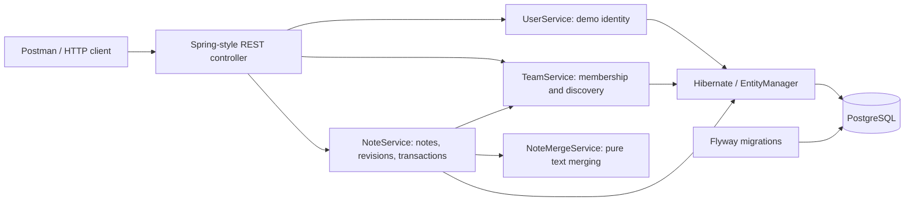

# Team Notes REST service

An interview-sized backend for several small teams to share notes. Kotlin on Java 21,
Quarkus, Spring-style controllers/services, Hibernate ORM, and PostgreSQL.

The service supports team-scoped CRUD, optimistic concurrency control, immutable
revision snapshots, and conservative three-way merging. It is a single deployable
application with one relational database. There is no frontend; Postman, curl, and
HTTP integration tests exercise the API.

For a first review, start with [running the service](#run), the
[three key design decisions](#three-key-design-decisions), and the
[code review path](#suggested-code-review-path). See [API](#api) for the contract,
[verification](#verification) for automated tests, and
[what I would change with more time](#what-i-would-change-with-more-time) for next steps.

## Scope and working assumptions

Every note belongs to one team. Every member may read, create, edit, and delete that
team's notes. A user may belong to several teams. Users and memberships are seeded;
there is no signup or team administration API. These are initial product assumptions
for discussion, not requirements inferred from a supplied specification.

The demo identifies callers with `X-User-Id`. **This is impersonation for local testing,
not authentication:** anyone who knows a seeded ID can act as that user. Do not expose
this sample as a production service. Team authorization is enforced independently
on every note operation. Missing, malformed, or unknown identities return 401;
inaccessible teams and notes return 404 to avoid disclosing their existence.

## Run

Prerequisite: Docker with Compose. From the project root:

```sh
docker compose up --build -d
curl http://localhost:8080/q/health/ready
```

The first build downloads dependencies. PostgreSQL must become healthy before the
application starts. Flyway applies the schema and demo data automatically. The service
listens on localhost:8080; PostgreSQL defaults to localhost:5432. If a local PostgreSQL
already uses 5432, create a gitignored `.env` file in the project root:

```dotenv
APP_PORT=8080
DB_PORT=5433
```

Compose reads this file automatically. Postman still uses `http://localhost:8080`.
The API container always connects to `db:5432` internally, regardless of the host port.
PostgreSQL runs in the separate `db` container using `postgres:17`; it does not run
inside the API container or use your locally installed PostgreSQL. Its data lives in
the Compose-managed `notes-data` volume. Both published ports bind to `127.0.0.1`.

The [Dockerfile](Dockerfile) builds with `maven:3.9.9-eclipse-temurin-21` and copies the
Quarkus JVM application into `eclipse-temurin:21-jre`, running as user `1001`.
The image build skips tests; run the verification command separately before delivery.
[compose.yaml](compose.yaml) supplies database configuration and waits for PostgreSQL's
health check before starting the API. This provides a small, reproducible local setup;
it is not a production deployment configuration.

```sh
docker compose logs -f app
docker compose down
```

Stopping preserves database data in a named volume. `docker compose down -v` deletes
that demo data permanently. Docker image tags pin major runtime versions but are not
immutable digests; a production release should pin and update digests deliberately.

For development, install JDK 21 and run:

```sh
docker compose up -d db
./mvnw quarkus:dev
```

If Compose exposes PostgreSQL on 5433, use
`DB_URL=jdbc:postgresql://localhost:5433/notes ./mvnw quarkus:dev` instead.
The Maven command does not automatically read Compose's `.env` file.

Use `mvnw.cmd` on Windows. The wrapper installs Maven 3.9.9 on first use. Stop the Compose
app first if it occupies port 8080. To build and run a JVM artifact:

```sh
./mvnw verify
java -jar target/quarkus-app/quarkus-run.jar
```

Keep the entire `target/quarkus-app` directory when distributing the artifact.
`DB_URL`, `DB_USER`, and `DB_PASSWORD` override the local database defaults.
Swagger UI: http://localhost:8080/q/swagger-ui ; OpenAPI: http://localhost:8080/q/openapi .
Health endpoints are public and do not require a demo identity.

## Demo identities

| User | X-User-Id | Teams |
| --- | --- | --- |
| Alice | `00000000-0000-0000-0000-000000000001` | Engineering |
| Bob | `00000000-0000-0000-0000-000000000002` | Engineering, Design |
| Charlie | `00000000-0000-0000-0000-000000000003` | Design |

Engineering: `10000000-0000-0000-0000-000000000001`.
Design: `10000000-0000-0000-0000-000000000002`.

## API

All `/api` requests require `X-User-Id`. JSON requests require `Content-Type: application/json`.

| Method | Path | Behavior |
| --- | --- | --- |
| GET | `/api/teams` | List the caller's teams |
| GET | `/api/teams/{teamId}/notes?page=0&size=20` | Page of team notes |
| POST | `/api/teams/{teamId}/notes` | Create; 201 with Location header |
| GET | `/api/teams/{teamId}/notes/{noteId}` | Read; 200 |
| PUT | `/api/teams/{teamId}/notes/{noteId}` | Replace title/content using current version; 200 |
| DELETE | `/api/teams/{teamId}/notes/{noteId}?version=0` | Delete note and revisions using current version; 204 |
| GET | `/api/teams/{teamId}/notes/{noteId}/revisions?page=0&size=20` | History, newest version first; 200 |
| GET | `/api/teams/{teamId}/notes/{noteId}/revisions/{version}` | Read a saved revision; 200 |
| POST | `/api/teams/{teamId}/notes/{noteId}/merge` | Merge a draft against its original revision and save; 200 or 409 |

POST body: `{"title":"Planning","content":"Discuss milestones"}`.
PUT body: `{"title":"Updated planning","content":"New milestones","version":0}`.
Merge body: `{"title":"Planning","content":"My draft","baseVersion":0}`.
The merge request must contain the complete draft and the version originally edited;
`baseVersion` is not the latest version fetched after a conflict.

Titles must be nonblank, are trimmed, and have no field-specific length limit (the 128 KB
request body limit still applies); content is required,
may be empty, and is limited to 50,000 characters. Application limits count UTF-16 code
units. Request bodies are additionally capped at 128 KiB. A PUT must supply both fields
and a nonnegative version. Omitted fields do not mean “leave unchanged.” Deletes also
require a version so a stale client cannot silently delete a newer edit.

Responses include `id`, `teamId`, `title`, `content`, `createdBy`, `updatedBy`, `createdAt`,
`updatedAt`, and `version`. Timestamps use UTC ISO-8601. New notes start at version 0.
Updates increment the version. A stale version returns 409; fetch the latest note and
resolve the conflict before retrying. Hibernate's version predicate also protects
against writes that race after the application's version check.

List responses contain `items`, `page`, `size`, and `total`. Pages are zero-based;
size is 1–100, page is 0–100000. Ordering is `updatedAt DESC, id DESC` for deterministic
ties. Offset pagination is easy to demonstrate; edits during pagination can move rows,
and count and list are separate queries, so this is not a snapshot of an active team.

Application errors have `{"status":400,"message":"..."}`. Malformed JSON and transport
errors may use framework-provided bodies. Invalid input returns 400; missing resources
return 404; unsupported media types return 415. A repeated successful delete returns 404.

### Try it with curl or Postman

1. Start the service with Compose and confirm `/q/health/ready` responds successfully.
2. In Postman, choose **Import** and select
   [team-notes.postman_collection.json](postman/team-notes.postman_collection.json).
3. Open the collection's variables. Keep `baseUrl` at `http://localhost:8080` (or use
   your configured API port). The seeded `userId` and `teamId` are already supplied;
   no separate Postman environment is required. Avoid environment variables with the
   same names overriding collection values.
4. Use **Run collection** in its supplied order, or send individual requests from top
   to bottom. Inspect each response and the **Test Results** assertions. Expected
   401/404/409 responses in negative scenarios are intentional.

The collection contains 22 requests. Run requests in order; the create
and update requests capture the note ID and version automatically. The collection
includes a cross-team denial and a stale-edit example. The **Revision history and
conflict resolution** folder creates its own note and demonstrates automatic merging,
overlapping conflicts, manual resolution, restoration, authorization, and deletion.
Run that folder in order; it keeps the original and current versions in separate variables.

```sh
curl -i http://localhost:8080/api/teams/10000000-0000-0000-0000-000000000001/notes \
  -H 'X-User-Id: 00000000-0000-0000-0000-000000000001' \
  -H 'Content-Type: application/json' \
  -d '{"title":"Planning","content":"Discuss milestones"}'

curl http://localhost:8080/api/teams/10000000-0000-0000-0000-000000000001/notes \
  -H 'X-User-Id: 00000000-0000-0000-0000-000000000002'
```

## Architecture and reasoning



- **Kotlin / Java 21:** concise immutable response types and explicit nullable request
  fields, with the JVM ecosystem. JPA entities remain ordinary mutable classes with
  no-argument construction; they are deliberately not data classes. Revision snapshots are immutable.
- **Quarkus:** one runtime owns HTTP, dependency injection, transaction management,
  and persistence. Development reload and disposable database support aid iteration.
  JVM deployment keeps the build simple; native images are not necessary for this scope.
- **Spring annotations:** Quarkus's Spring Web and DI compatibility extensions support
  familiar `@RestController` and `@Service` APIs. **This application does not run Spring
  Boot or a Spring application context.** Arbitrary Boot starters/autoconfiguration are
  not supported. This choice follows the requested Quarkus infrastructure and Spring-style
  application code. If Boot itself were mandatory, I would use Boot as the sole runtime.
  A new Quarkus-only project could use Jakarta REST/CDI to reduce compatibility surface.
- **Hibernate / JPA:** maps notes and supplies optimistic locking and transaction-aware
  persistence. A small service uses `EntityManager` directly; a repository abstraction
  can be extracted when queries grow. DTOs keep persistence entities out of the API.
  JDBC operations execute on worker threads through `@Blocking`.
- **PostgreSQL:** the domain has relational membership and ownership constraints.
  Foreign keys and checks protect stored data; an index supports team-scoped listing.
  UUIDs avoid exposing sequential identifiers, but are not an authorization mechanism.
  User/team lookup uses typed, parameterized JPQL queries against mapped Hibernate
  entities. Scalar UUID references keep authorization queries explicit without loading
  object graphs. SQL is confined to schema migrations and database-focused tests.
- **Flyway:** versioned SQL makes schema changes reviewable and repeatable. Hibernate
  validates the schema rather than changing it automatically. The second migration
  deliberately installs demo data and would be separated from production migrations.
- **REST and a single service:** appropriate for CRUD at small-team scale. No broker,
  cache, search cluster, or microservice split is needed to demonstrate this domain.
- **Explicit version checks:** cooperative editing can otherwise lose work silently.
  Returning 409 gives callers a recovery path. An explicit merge endpoint adds conservative
  three-way merging without changing strict PUT semantics. JSON versions are easy to
  exercise in Postman; ETag/If-Match is an alternative.
- **Maven wrapper and Compose:** a reviewer gets consistent build tooling and a reproducible
  local database. Tests use real PostgreSQL to exercise migrations and SQL behavior.

There is no service-to-service network boundary or asynchronous workflow. Each write is
one transaction. Memberships are immutable through this API; if membership administration
is added, define how revocation should interact with in-flight writes.

## Three key design decisions

These are the three decisions that most shaped the implementation and its tradeoffs.

### 1. One Quarkus runtime with Spring-style application code

I chose Kotlin and Quarkus for the JVM service, with Spring Web/DI compatibility to
retain familiar controller and service annotations. Quarkus owns dependency injection,
HTTP handling, Hibernate, and transactions; there is no second Spring Boot runtime.
This meets the requested infrastructure and coding style while keeping one application
lifecycle. Kotlin provides concise DTOs and explicit nullability; Java 21 and Maven
keep the build familiar and repeatable.

The cost is compatibility scope: Spring annotations do not imply support for arbitrary
Spring Boot starters. Given a fresh choice without the mixed-framework preference,
I would use Jakarta REST/CDI throughout Quarkus, or choose Spring Boot alone if its
autoconfiguration ecosystem were a requirement. I would not combine two runtimes.

### 2. Treat teams as tenants in one shared schema

I chose a shared PostgreSQL schema with explicit membership checks and team-scoped
queries because several small teams do not warrant separate databases and migration
pipelines. Authorization lives in `TeamService` and is called by every public note
operation. Looking up a note requires both its ID and the authorized team ID. Database
constraints also prevent a revision from referring to a note in a different team.

The cost is that future queries must maintain those access predicates. This is not
automatic database tenant isolation. With more time, I would first replace the demo
identity header with trusted authentication, then evaluate PostgreSQL row-level
security for additional enforcement. Private notes within a team would require
additional permissions; team tenancy alone does not provide that feature.

### 3. Versioned saves, atomic history, and conservative merging

I chose Hibernate optimistic locking instead of holding locks while users edit.
The first successful update wins; a stale update receives 409 instead of silently
overwriting someone else's work. Every successful save records a full revision in
the same transaction, providing an original version for three-way merging and a
simple restoration workflow. Strict PUT and explicit POST merge keep client intent
clear and make both paths testable in Postman.

The tradeoff is storage growth from full snapshots and manual resolution for
ambiguous changes. The merge algorithm uses one changed line span per writer, so it
can reject edits a more sophisticated diff could combine. With more time, I would
add a comparison UI, retention/deletion policy, and idempotency keys before considering
live CRDT collaboration. Yjs could complement this Kotlin backend through a separate
collaboration service; it does not require rewriting the REST application.

## Code organization

Each class has its own file under `src/main/kotlin/com/example/notes`:

- `controller`: HTTP routes and request/response handling.
- `service`: membership checks, validation, transactions, and entity-to-response mapping.
- `entity`: mutable Hibernate entities; required note fields use constructor properties.
- `model`: request and response DTOs, including paginated results and error bodies.
- `exception`: application exceptions and HTTP exception mappers.

Controllers and services use constructor injection. `NoteController` handles note CRUD
and revision reads, `NoteMergeController` handles merge requests, and `TeamController`
handles team discovery. Their existing API paths remain unchanged.

`UserService` validates the demo identity against `AppUser`. `TeamService` handles
membership authorization and team discovery. `NoteService` delegates membership checks
to `TeamService` on every public note operation, keeping access enforcement inside the
service layer. It owns note validation, persistence, revision snapshots, and transactional
merge orchestration; the injected `NoteMergeService` supplies the text merge algorithm.
Saving a merged note and recording its revision still happen in one transaction.

Database queries in these services use typed `EntityManager.createQuery` against Hibernate
entities. `MembershipId` maps the existing `(user_id, team_id)` composite primary key.
These mappings use UUID references, matching the note entities, without loading associated
objects for authorization checks. No native SQL queries are used in the services.

The Kotlin JPA compiler plugin supplies Hibernate's no-argument constructor. The current
entities are simple scalar mappings without lazy associations. Note revisions use immutable
properties and Hibernate's `@Immutable`; no API updates individual snapshots. DTOs remain
immutable data classes; entities have no dependency on API models. Annotation/property pairs use separate
lines, and multiline parameter lists use trailing commas.

### Suggested code review path

All Kotlin paths below are relative to `src/main/kotlin/com/example/notes`.

| Start here | What to review |
| --- | --- |
| [NoteController](src/main/kotlin/com/example/notes/controller/NoteController.kt), [NoteMergeController](src/main/kotlin/com/example/notes/controller/NoteMergeController.kt) | REST contract, identity handling, status codes, and separation of CRUD from merging |
| [NoteService](src/main/kotlin/com/example/notes/service/NoteService.kt) | Public use cases first, then private validation/query/snapshot helpers; transaction and version boundaries |
| [UserService](src/main/kotlin/com/example/notes/service/UserService.kt), [TeamService](src/main/kotlin/com/example/notes/service/TeamService.kt) | Demo identity validation and tenant access checks |
| [NoteMergeService](src/main/kotlin/com/example/notes/service/NoteMergeService.kt) | Stateless three-way merge rules and ambiguous cases |
| [Entities](src/main/kotlin/com/example/notes/entity), [migrations](src/main/resources/db/migration) | Users, teams, composite membership key, versioned notes, immutable revisions, and database constraints |
| [Models](src/main/kotlin/com/example/notes/model), [exceptions](src/main/kotlin/com/example/notes/exception) | Separate request/response DTOs and conflict/error representations |
| [Tests](src/test/kotlin/com/example/notes), [Postman collection](postman/team-notes.postman_collection.json) | Executable examples and edge cases |
| [Configuration](src/main/resources/application.properties), [pom.xml](pom.xml), [Compose](compose.yaml) | Runtime settings, dependencies, and local deployment |

Flyway V1 creates the initial schema with an unrestricted `TEXT` title, V2 seeds the
demo identities and memberships, and V4 adds/backfills revision history. The version
gap is intentional: the former V3 title-length change was folded into V1 during local
sample development. For an existing database initialized from the older V1, reset the
local demo volume only if its data is disposable. In a deployed system I would keep
applied migrations immutable and introduce a new migration instead.

## Team tenancy and isolation

For this sample, a team is the logical tenant. All teams share one database and schema;
`note.team_id` identifies the owning tenant. Every note operation first checks the
caller's membership. Lists and counts filter by team, and individual lookups use both
team ID and note ID. Creates take ownership from the authorized URL team, not the body.
An ID from another team therefore cannot be used to read, update, or delete a note
through the current team's URL, even by a user who belongs to both teams.

This is application-enforced tenant isolation, not Hibernate's automatic tenant filtering
or database-enforced row security. It suits several small teams with the same schema
and keeps migrations and local deployment straightforward. Future queries must preserve
the same membership and team predicates. The demo identity header still allows
impersonation; trusted authentication is needed before this becomes a security boundary
for real users.

Possible approaches as requirements grow:

| Approach | Benefit | Tradeoff |
| --- | --- | --- |
| Shared schema with explicit team predicates (current) | Simple queries, deployment, and migrations | Every query must enforce isolation |
| Hibernate discriminator tenancy | Centralizes ORM tenant filtering | Requires trusted tenant resolution and careful review of native SQL |
| PostgreSQL row-level security | Additional database enforcement | Requires policies, transaction-scoped tenant context, and a runtime role that cannot bypass policies |
| Schema or database per tenant | Separate namespaces or databases | More provisioning, migration, connection, and operational work |

I would retain shared-schema tenancy here. If stronger isolation is requested, consider
PostgreSQL row-level security as defense in depth after adding real authentication.
Table owners normally bypass row security, so the application should not simply reuse
a privileged migration role. See [PostgreSQL row security](https://www.postgresql.org/docs/17/ddl-rowsecurity.html)
and [Quarkus Hibernate tenancy](https://quarkus.io/guides/hibernate-orm/#multitenancy).
Neither additional mechanism is implemented in this sample.

A `TenantEntity` base class can reduce repetition once several entities share tenant
ownership; inheritance alone does not enforce authorization. Explicit `teamId` fields on notes and revisions keep ownership visible; their
composite foreign key also prevents a revision from belonging to a different team than its note. If several teams later belong to one customer
organization, make that organization the tenant and keep team permissions inside it.
Notes hidden from members of their own team would need a separate visibility/ownership
or ACL rule; tenant isolation only hides notes from other teams.

## Revision history and concurrent editing

### Current behavior and manual conflict resolution

Optimistic locking prevents silent overwrites: when two coworkers edit the same
version, the first successful database update wins. The other save receives `409`.
The rejected draft is not stored by the server; the client must preserve it. The
current API also supports manual conflict resolution using ordinary GET and PUT:
fetch the latest note, reconcile the draft with it, then PUT the chosen title and
content with the latest version. If another save intervenes, resolve the new conflict.
Never automatically replace the draft's version and resend unchanged content: that
can overwrite the coworker's changes despite satisfying the version check.

A frontend would make this easier by preserving the original note and unsaved draft,
displaying the latest saved text alongside the draft, and letting the user edit a
combined result or explicitly choose one version. A UI is not required to test the
backend workflow. In Postman, before deleting the test note:

1. Create a note with title `Planning` and content `Agenda`; its version is `0`.
2. Use separate Alice and Bob requests with their respective `X-User-Id` headers.
   Both GET the same note and retain version `0` and the original text.
3. Alice PUTs `{"title":"Planning","content":"Agenda: budget","version":0}`.
   Expect `200` and version `1`.
4. Bob PUTs `{"title":"Planning","content":"Agenda: staffing","version":0}`.
   Expect `409`; keep Bob's draft in the request body.
5. Bob GETs the note and sees Alice's text and version `1`. Manually combine the
   intended edits and PUT
   `{"title":"Planning","content":"Agenda: budget and staffing","version":1}`.
   Expect `200` and version `2`, provided no other edit intervenes.
6. GET again as Alice and verify the combined content.

Use literal versions or separate `aliceVersion` and `bobVersion` variables for this
exercise. The collection's shared `version` variable is automatically updated after
saves and would otherwise conceal Bob's stale state.

### Implemented revision history

Every successful create, PUT, or merge records a full snapshot in `note_revision`,
including note/team IDs, version, title, content, editor, and timestamp. The note and
snapshot commit in the same transaction; rejected writes leave no history entry.
`(note_id, version)` is unique. Snapshots cannot be edited through the API.

History endpoints enforce the same team membership and note ownership as normal reads.
Lists return `items`, `page`, `size`, and `total`, ordered by version descending, with
page 0–100000 and size 1–100 (default 20). Like note listing, count and page queries are
not a single snapshot during concurrent writes. A missing revision returns 404.

To restore an earlier revision, GET it, GET the current note, and PUT the historical
`title` and `content` using the current note's `version`. Restoration creates a new
version and retains intervening snapshots. A stale restore is rejected like any PUT.
Deleting a note cascades to its revisions; this is history for existing notes, not
recovery of deleted notes. The V4 migration backfills the current state of existing
notes at their current version. Earlier states cannot be reconstructed, so attempts
to merge from an unavailable base revision return 404.

### Combining coworkers' changes

`POST /api/teams/{teamId}/notes/{noteId}/merge` compares three values: the stored revision
identified by `baseVersion`, the latest note, and the submitted draft. It saves immediately
on success and returns the new `NoteResponse` with version and editor metadata.

- If only one writer changed a field, use that change; identical changes agree.
- Treat the title as one field. Different edits to the title require a decision.
- For content, compare newline-separated lines and merge disjoint changed ranges.
  For example, Alice can change a budget line while Bob changes a staffing line.
- Return `409` for overlapping ranges or ambiguous insertions at a change boundary.
  No partial result is saved. The response has `code: "MERGE_CONFLICT"`, `base`,
  `current`, `draft`, `conflictingFields`, `mergedTitle`, and `mergedContent`.
  The merged fields contain the safely resolved values, or null where a decision is
  required. All three input versions are included so a client can show a comparison.
- Submit the manually resolved title/content through PUT with `current.version`.
  If another save intervenes, fetch the latest note and reconcile again. A race during
  an otherwise safe merge also returns a normal optimistic-lock 409; no automatic retry
  overwrites the winner. Submitted drafts remain the client's responsibility.

Example: start with `Budget: pending\nStaffing: pending` at version 0. Alice PUTs
`Budget: approved\nStaffing: pending` with version 0. Bob then POSTs:

```json
{
  "title": "Planning",
  "content": "Budget: pending\nStaffing: hired",
  "baseVersion": 0
}
```

The result is `Budget: approved\nStaffing: hired` at version 2. If Bob instead changes
the budget line, the endpoint returns a conflict for human resolution. Both success
and conflict paths are demonstrated in the Postman folder.

The algorithm deliberately uses one contiguous changed line range per writer, found
from common prefixes/suffixes in linear time. Multiple separated edits by one writer
can therefore conservatively conflict with another edit between them. Edits to different
words of the same line also conflict. This avoids a quadratic diff over large request
bodies and makes behavior easy to explain; it is not a full text editor merge engine.
Line endings are preserved, and the merged result must still satisfy content limits.
A merge producing more than 50,000 content characters returns 400 without saving.
Successful merge requests, including unchanged or repeated drafts, are saves and create
a new revision; there is no idempotency-key support.

### What I would add with more time

A frontend could retain unsaved drafts, show differences, and let coworkers accept or
edit a proposed resolution. More precise multi-hunk or word-level merging could reduce
false conflicts, but requires careful handling of repeated text and rich-text structure.
Full revision snapshots are straightforward but increase storage; retention limits,
soft deletion, and compact storage need explicit product decisions. Idempotency keys
would make retries after uncertain network outcomes easier. Real-time editing is a
separate extension described below, not part of this REST implementation.

### Live collaboration with Yjs

Using Yjs would not require rewriting this Kotlin/Quarkus service. Yjs is a JavaScript
CRDT library with editor integrations and network providers; a browser editor could
use it while Kotlin continues to own users, teams, authorization, and REST endpoints.
See the [Yjs documentation](https://docs.yjs.dev/).

My proposed deployment would add a Node.js collaboration service using a compatible
WebSocket provider alongside the Kotlin API. That avoids implementing the Yjs protocol
in Kotlin, but introduces another runtime and deployment component. A Kotlin transport
is possible in principle, but ordinary WebSocket support alone does not implement the
Yjs synchronization protocol. The provider distributes document updates and presence
information; persistence and authorization integration must be designed explicitly.
See [y-websocket](https://docs.yjs.dev/ecosystem/connection-provider/y-websocket).

| Option | Benefit | Cost or limitation |
| --- | --- | --- |
| Versioned REST saves (current) | Small backend, explicit conflicts, easy Postman testing | Users manually reconcile edits |
| Revision history and manual resolution (implemented) | Review, recovery, and an original version for comparison | Snapshot storage, retention decisions, and user effort |
| Conservative three-way merge (implemented) | Combines different fields or disjoint line ranges | Overlaps and ambiguous ranges require manual resolution |
| Yjs live collaboration | Concurrent editing with synchronized document changes | Editor integration, collaboration service, protocol-aware persistence, reconnect and scaling tests |

For Yjs, I would establish one authoritative representation of note content: persist
CRDT updates/checkpoints and derive readable snapshots, rather than allow independent
whole-text PUTs and CRDT writes to overwrite each other. Team membership must govern
document subscriptions and writes, including revocation. CRDT convergence does not
guarantee that combined edits express users' intended meaning or replace revision history.
I would test synchronization with actual Yjs clients; the manual REST/Postman workflow
above remains suitable for the current architecture. For this interview's backend-only
scope, revision history and explicit conflict resolution keep the implementation manageable.

## Verification

With JDK 21 and Docker running:

```sh
./mvnw verify
```

Quarkus Dev Services starts a disposable PostgreSQL 17 database for tests; the test
profile does not point to the Compose development database. The HTTP tests exercise
shared CRUD, team discovery, cross-team isolation, stale updates/deletes, identity errors,
and input/pagination validation. Additional tests cover revision snapshots, migration
backfill, restoration, deletion cascades, tenant isolation, automatic and manual merges,
merge size limits, and competing HTTP saves (one winner, no losing revision). Unit tests
call the services directly: identity validation, team authorization and response mapping,
note validation, snapshot attribution, stale writes, and deletion. Mockito supplies the
EntityManager and team-access dependencies; these tests do not start Quarkus or a database.
The merge algorithm tests use real strings and cover merge boundaries, insertions/deletions,
and line endings. No H2 substitute is used.

The current suite contains 100 cases: 75 service unit cases and 25 HTTP/database or
migration cases. This is a test count, not a measured code-coverage percentage.

| Test class | Focus |
| --- | --- |
| `NoteServiceTest` (59) | Authorization, validation, paging, versions, snapshot attribution, merge orchestration, and failure paths with mocked persistence |
| `NoteMergeServiceTest` (8) | Real merge algorithm, disjoint edits, overlap, insertions/deletions, Unicode, and line endings |
| `UserServiceTest` / `TeamServiceTest` (4 each) | Identity, membership, and team response mapping |
| `NoteApiTest` (18) | Actual HTTP CRUD, access isolation, validation, and version behavior |
| `NoteRevisionApiTest` (6) | Actual persistence, merging, restoration, competing writes, cascades, and transaction rollback |
| `RevisionMigrationTest` (1) | Upgrade from V2 to V4 and backfill in an isolated schema |

Maven writes individual results to `target/surefire-reports`. The Postman collection
is a separate manual/collection-runner workflow; Maven does not execute it.

Run only the service unit tests (JDK 21 required; Docker is not needed):

```sh
./mvnw -Dtest=UserServiceTest,TeamServiceTest,NoteServiceTest,NoteMergeServiceTest test
```

`NoteApiTest` uses real HTTP requests against the Quarkus test server and PostgreSQL,
without mocked services. Its scenarios are named separately, and created notes are cleaned
up after each test. Mock-based tests do not verify query execution, transaction rollback,
or Hibernate version increments; the API and migration tests cover those database behaviors.

Additional edge-case coverage includes authorization before storage access for every
note operation, missing resources, negative and future versions, pagination limits,
Unicode UTF-16 content limits, partial merge conflicts, and snapshot persistence failures.
HTTP tests verify empty request bodies, unchanged saves creating new revisions, and
empty pages preserving totals. A PostgreSQL test forces rollback after a note and its
revision have flushed, verifying that neither change survives. A deterministic merge
matrix checks disjoint replacements in both writer orders, including repeated and blank
lines, Unicode, and trailing newlines.

Quarkus Spring Web currently returns 404 when a pagination parameter cannot be parsed
as an integer; integers that parse but fall outside the service's bounds return 400.
Both behaviors are covered explicitly by HTTP tests.

These are correctness checks, not sustained load or exhaustive concurrency testing.

## What I would change with more time

I would prioritize these changes according to the service's actual users and workload:

1. **Trusted identity and team administration.** Replace `X-User-Id` impersonation
   with OIDC/JWT identity mapped to an application user. Add invitations, membership
   management, and explicit owner/editor roles. Define how revocation affects in-flight
   writes, and separate demo seeding from production migrations.
2. **A usable conflict workflow.** Add a frontend that preserves drafts and displays
   base/current/draft differences with editable resolutions. Evaluate a more precise
   diff with benchmarks and repeated-text tests. Add idempotency keys for uncertain
   network retries; consider Yjs only if live editing becomes a product requirement.
3. **History lifecycle and stronger isolation.** Decide retention, soft deletion,
   restore permissions, and storage limits before snapshots grow indefinitely.
   Evaluate row-level security with separate migration/runtime roles. Add private-note
   permissions only when required; they are separate from team membership.
4. **Operational readiness and scale evidence.** Add deployment-managed secrets,
   TLS, backups with restore drills, structured logs/metrics, and load tests against
   realistic team sizes. Consider cursor pagination when concurrent changes and deep
   offsets matter. Add CI to run `./mvnw verify`; the Docker image build skips tests.
5. **A more uniform API contract.** Normalize framework parse errors and malformed
   JSON into the same error shape as application errors, including changing invalid
   integer pagination from the current 404 to 400. Consider ETag/If-Match as an HTTP
   alternative to JSON versions, with a documented client migration path.

These are follow-ups, not implemented capabilities. The sample deliberately keeps
one service and one database; caches, queues, and additional services would need a
measured workload or product requirement to justify them.

## Framework references

- [Quarkus Spring Web compatibility and limitations](https://quarkus.io/guides/spring-web/)
- [Quarkus Spring dependency injection](https://quarkus.io/guides/spring-di/)
- [Kotlin on Quarkus](https://quarkus.io/guides/kotlin/)
- [Hibernate ORM on Quarkus](https://quarkus.io/guides/hibernate-orm/)
